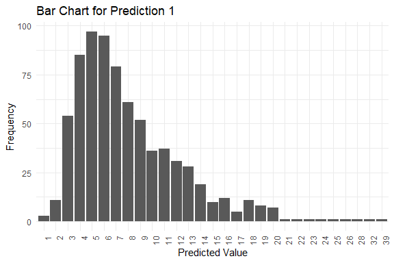
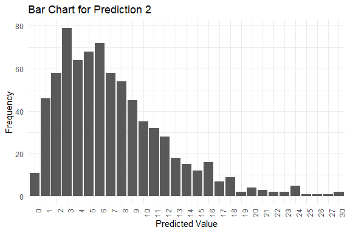
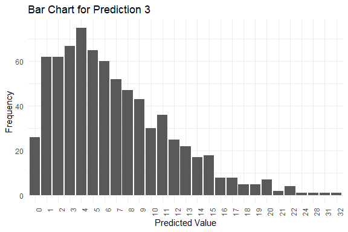
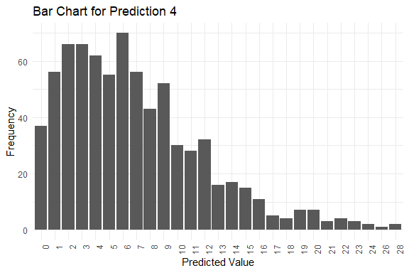
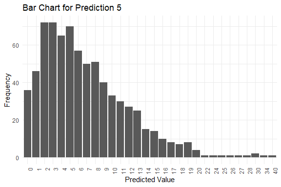

<!--  README.md is generated from README.Rmd. Please edit that file -->

The First-order Integer-valued Autoregressive (INAR(1)) model with
zero-inflated (ZI-INAR(1)) and hurdle (H-INAR(1)) innovations is widely
used in studying integer-valued time-series data, such as crime count
and heatwave frequency. This work implemented the INAR(1) models in
Stan.

## Installation

You can install ZIHINAR1 from GitHub with:

``` r
remotes::install_github("fushengyy/ZIHINAR1")
```

Or you can install the released version of ZIHINAR1 from
[CRAN](https://CRAN.R-project.org) with:

``` r
install.packages("ZIHINAR1")
```

## Basic Features get_stanfit()

The package contains main function named get_stanfit().

``` r
stan_fit <- get_stanfit(mod_type, distri, y, n_pred = 4,
                        thin = 2, chains = 1, iter = 2000, warmup = iter/2,
                        seed = NA)
```

- `mod_type`: Character string indicating the model type. Use `"zi"` for
  zero-inflated models and `"h"` for hurdle models.

- `distri`: Innovation distribution. Options:

  - `"poi"`: Poisson

  - `"nb"`: Negative Binomial

  - `"gp"`: Generalized Poisson (ZI only)

- `y`: A numeric vector of integers representing the observed data.

- `n_pred`: Integer specifying the number of time points for future
  predictions (default is 4).

- `thin`: Integer indicating the thinning interval for Stan sampling
  (default is 2).

- `chains`: Integer specifying the number of Markov chains to run
  (default is 1).

- `iter`: Integer specifying the total number of iterations per chain
  (default is 2000).

- `warmup`: Integer specifying the number of warmup iterations per chain
  (default is `iter`/2).

- `seed`: Numeric seed for reproducibility (default is NA).

## Example

The following are examples showing how to fit the INAR(1) model when
data is generated from a zero-inflated Negative Binomial (ZINB)
distribution.

``` r
library(ZIHINAR1)
y_data <- data_simu(n = 100, alpha = 0.5, rho = 0.3, lambda = 5, disp = 2, 
                    mod_type = "zi", distri = "nb")
stan_fit <- get_stanfit(mod_type = "zi", distri = "nb", y = y_data, n_pred = 5, 
                        iter = 2000, chains = 1, warmup = 500, 
                        thin = 2, seed = 42)
#> 
#> SAMPLING FOR MODEL 'anon_model' NOW (CHAIN 1).
#> Chain 1: 
#> Chain 1: Gradient evaluation took 0.000715 seconds
#> Chain 1: 1000 transitions using 10 leapfrog steps per transition would take 7.15 seconds.
#> Chain 1: Adjust your expectations accordingly!
#> Chain 1: 
#> Chain 1: 
#> Chain 1: Iteration:    1 / 2000 [  0%]  (Warmup)
#> Chain 1: Iteration:  200 / 2000 [ 10%]  (Warmup)
#> Chain 1: Iteration:  400 / 2000 [ 20%]  (Warmup)
#> Chain 1: Iteration:  501 / 2000 [ 25%]  (Sampling)
#> Chain 1: Iteration:  700 / 2000 [ 35%]  (Sampling)
#> Chain 1: Iteration:  900 / 2000 [ 45%]  (Sampling)
#> Chain 1: Iteration: 1100 / 2000 [ 55%]  (Sampling)
#> Chain 1: Iteration: 1300 / 2000 [ 65%]  (Sampling)
#> Chain 1: Iteration: 1500 / 2000 [ 75%]  (Sampling)
#> Chain 1: Iteration: 1700 / 2000 [ 85%]  (Sampling)
#> Chain 1: Iteration: 1900 / 2000 [ 95%]  (Sampling)
#> Chain 1: Iteration: 2000 / 2000 [100%]  (Sampling)
#> Chain 1: 
#> Chain 1:  Elapsed Time: 3.277 seconds (Warm-up)
#> Chain 1:                9.208 seconds (Sampling)
#> Chain 1:                12.485 seconds (Total)
#> Chain 1:
get_est(distri = "nb", stan_fit = stan_fit)
#>             Mean         SD    Median       Q2.5     Q97.5      Rhat
#> alpha  0.5307909 0.04108348 0.5327549 0.44979898 0.6019402 1.0047284
#> rho    0.3696123 0.12017678 0.3837477 0.07870574 0.5645864 1.0047853
#> lambda 4.9954050 0.82387796 5.0098591 3.52989514 6.5890245 0.9998295
#> phi    2.4923431 1.50853128 2.1013737 0.70294059 6.5018753 0.9997752
#>        95%_HPD_Lower 95%_HPD_Upper
#> alpha     0.45032117     0.6028335
#> rho       0.08011943     0.5648035
#> lambda    3.64535329     6.6350831
#> phi       0.48503911     5.3722200
get_mod_sel(y = y_data, mod_type = "zi", distri = "nb", stan_fit = stan_fit)
#>       EAIC     EBIC      DIC    WAIC1    WAIC2
#> 1 519.2344 529.6149 527.1945 514.9319 515.2939
get_pred(stan_fit = stan_fit)
#> $summary
#>          Mode Median IQR Min Max
#> y_pred.1    5      7   5   1  39
#> y_pred.2    3      6   7   0  30
#> y_pred.3    4      6   7   0  32
#> y_pred.4    6      6   6   0  28
#> y_pred.5    2      6   7   0  40
#> 
#> $plots
#> $plots[[1]]
```



    #> 
    #> $plots[[2]]



    #> 
    #> $plots[[3]]



    #> 
    #> $plots[[4]]



    #> 
    #> $plots[[5]]


